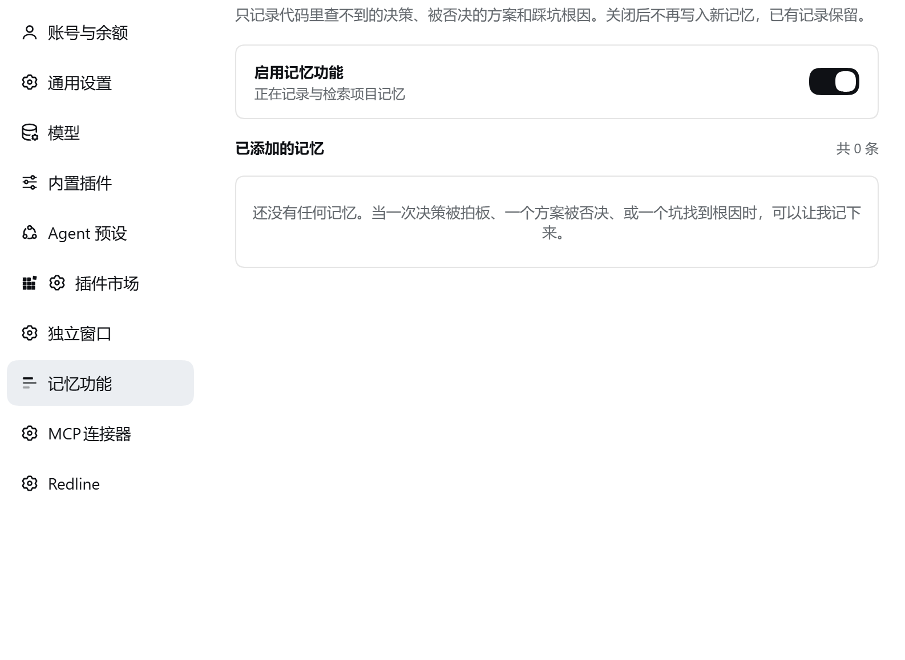

# dsh-memory-anchor

[中文](README.zh-CN.md) | English

Memory for DeepSeek Harness that records **only** the decisions, rejections and root causes
code cannot describe — each with a verify step — and reports where the memory still failed
to help.

## Screenshot



The plugin adds a **Memory** section to Settings: a switch that turns it on or off,
and the saved memories below it, ten per page.


### Scope

```
[]                     global — recall from anywhere
["workspace"]          the current workspace directory and everything under it
["src/surface/**"]     that path and its subtree
["workspace", "src/api/**"]  either one matches
```

`workspace` resolves against the working directory at recall time. **Prefer it over an
absolute path**, which breaks the moment the repository moves to another machine or folder.

A scope mismatch does not hide an entry — it halves its relevance, so a strong enough
match still surfaces.

## Embedding model (optional, recommended)

By default retrieval uses a **local character-hash vector**: no dependencies and works
offline, but it matches surface form only. Measured: about 20% on paraphrases and 0% across
languages — "提交前必须跑单测" does not find "合并代码之前需要执行自动化测试".

Configure an embedding provider in Settings and retrieval understands meaning:

| Pair | Local hash | Volcengine Ark |
|---|---|---|
| 提交前必须跑单测 ⟷ 合并代码之前需要执行自动化测试 | 0.081 | **0.674** |
| 禁止在事务里调外部接口 ⟷ 事务内不要发起跨服务请求 | 0.203 | **0.708** |
| Chinese query against an English memory | 0.000 | **0.604** |

These are measured values, not estimates.

### Configuration

Settings → Memory anchor → Embedding model: pick a provider, paste the API key, press
**Test connection**, then save. The key field is masked and toggleable, and the page
**never echoes the full key** — only its last four characters.

### Failure behaviour

An unreachable API never loses a memory: the write degrades to a local vector and is
flagged for upgrade. Once the API is back, recompute with `reindex`:

```
memory action=reindex              # dry run — reports how many need work
memory action=reindex apply=true   # execute; resumable
```

### Dimensions

1024 and 2048 measured about equally well (1024 slightly better on separation) while
using half the storage, so 1024 is the default.

## Install

Requires DeepSeek Harness `>=0.2.1-rc.3`.

```bash
# From npm
dsh plugin add dsh-memory-anchor

# Or from a local checkout
git clone https://github.com/JhengFire/dsh-memory-anchor.git
dsh plugin add ./dsh-memory-anchor
```

You can also install it without a terminal: open **Plugins > Add plugin** in the Harness and point it at the package directory.

The plugin registers one `memory` tool and adds a **Memory** section to Settings. There is nothing to configure before first use.

## What it does

A coding agent can read the code, but it cannot read why the code is the way it is. That knowledge — which approach was ruled out and on what grounds, which edge case already caused an outage — disappears unless someone writes it down. This plugin keeps only that narrow slice.

It deliberately does **not** store facts that are already derivable:

| Information | Better home |
|---|---|
| Where a symbol lives, who calls it | CodeGraph, LSP |
| Commit history, why a line changed | git |
| Team rules that must always apply | `AGENTS.md`, skills |
| **Why a decision was made, what was rejected, a root cause** | **this plugin** |

The moment it starts storing what other tools already answer, it rots.

## The `memory` tool

One tool, dispatched by `action`, rather than seven separate tools. Every registered tool adds a schema to every turn; seven of them would cost roughly three times the context of one, and a long tool list invites the model to call something just because it is there.

| action | Purpose |
|---|---|
| `find` | Retrieve memories for a query. Scoped by the current working directory first. |
| `add` | Record a `decision`, `constraint`, `gotcha` or `rejected`. Nothing else is accepted. |
| `verify` | Report whether a recalled memory still holds. Failure marks it stale. |
| `resolve` | Settle a conflict between two memories: keep one, or keep both as provisional. |
| `use` / `miss` | Report whether a recalled memory actually helped. This is what drives decay. |
| `stats` | Library health: how many entries lack a verification step. |
| `eval` | Where memory failed to help, grouped by failure type. |

## Why it is lightweight

- **Nothing is injected by default.** The system prompt gains one line of usage guidance, never memory content. A turn that does not call the tool costs nothing.
- **Writing is gated.** Only four situations may create an entry: a decision was made, an approach was rejected with a reason, a root cause was found, or a mistaken belief was corrected. Conversations are not summarised into memory at the end; that is where most noise comes from.
- **Every entry can be falsified.** `verify` holds one executable check. Read a memory and you can confirm it cheaply instead of trusting it.
- **Decay is driven by outcome, not time.** `use` and `miss` decide what survives. Something used once and still correct is not retired merely for being old.
- **One file, no services.** Records live in a storage domain: a readable, schema-validated, durable JSON unit. No daemon, no vector database, no network call.

## Conflicts are never settled silently

Two statements can contradict each other while sharing almost every word — "SNAPSHOT is forbidden in production" and "SNAPSHOT is allowed in production". Similarity measures cannot tell agreement from contradiction; they only report that the two are about the same thing.

So the plugin asks. A detected conflict is refused, with both sides shown, and only `resolve` settles it. Until then both entries stay marked `provisional` and every search shows the conflict, because a memory that pretends to be settled when it is not is worse than no memory at all.

Pure corrections — a date changed from yesterday to the day before — are applied automatically, and the old entry is kept as `superseded` so the change stays traceable.

## Reporting where it failed

Seven failure types are detected from recorded tool calls, not from self-reports:

| | Failure | Signal |
|---|---|---|
| F1 | Not recalled | An empty search, then the same topic was added minutes later |
| F2 | Recalled but unused | Results returned, no `use` followed |
| F3 | Verification failed | `verify` reported it no longer holds |
| F4 | Decision reopened | A second live decision on the same tags |
| F5 | Conflict | Two entries contradicting each other |
| F6 | Task unfinished | Optional; needs an external outcome signal |
| F7 | No feedback | Results returned, never used or rejected |

F7 is reported separately because it invalidates F2. If a session never reports feedback at all, "recalled but unused" cannot be distinguished from "recalled but nobody said". When F7 is high, the report says so explicitly instead of quietly producing numbers.

## Settings page

The plugin adds a **Memory** section to Settings:

- A switch that turns memory on or off. While off, `find`/`add`/`verify`/`resolve`/`use`/`miss` are refused; `stats` and `eval` still work, and this page stays readable, so turning memory off never hides what was already recorded.
- The saved memories, ten per page, newest first, with kind, status badges, `verify` command and path scope for each entry.

The switch persists to the profile patch, so it survives a restart.

## Configuration

All values are editable in the profile patch and survive upgrades.

| Field | Default | Meaning |
|---|---|---|
| `limit` | `5` | Results returned by `find` |
| `staleDays` | `180` | Days without verification before an entry turns stale |
| `retireMisses` | `3` | Misses without any use before an entry retires |
| `conflictWindowSec` | `1800` | Window within which a reversal counts as immediately decidable |
| `evalEnabled` | `true` | Record usage events for the failure report |
| `polarityPairs` | `[]` | Extra `affirmative=negated` pairs, one per line |
| `promptSection` | `true` | Add the one-line usage hint to the system prompt |

## Limitations

- Retrieval is **word-overlap similarity**, not semantic understanding. It matches the same language with shared surface terms; it does not match a Chinese query against an English entry, nor a synonym with no characters in common. This is why `verify` and path scoping exist.
- Conflicts require the opposing sides to share subject matter after polarity words are removed. Heavily reworded contradictions can be missed.
- The failure report describes what was recorded. It does not know whether a task actually succeeded unless an external signal is configured.

## Related

- [Design document, including every measured correction](docs/lightweight-agent-memory-design.md)
- [Detailed notes](docs/DETAIL.md)
- [Contributing](CONTRIBUTING.md)
- [Publishing](PUBLISHING.md)

## Licence

MIT
